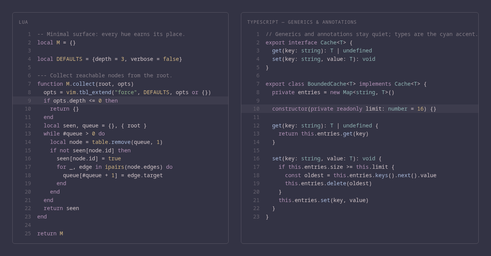

# friedrich

A minimal, dark Neovim colorscheme built from a fixed 16-color terminal palette.



## Style

**Minimal** is the design doctrine, in four parts:

- **Restricted hue set** — syntax uses four hues plus one accent: magenta for
  keywords, blue for functions, green for strings, yellow for constants, cyan
  for types. Everything else is foreground or a derived gray.
- **Muted saturation** — every color comes from the palette anchors below; no
  hue is ever tuned in place.
- **No text decoration** — no bold, no italic, no underline. Functional
  indicators (diagnostic and spelling undercurl) are the single exemption.
- **UI chrome recedes** — statusline, line numbers, borders, and floats use
  derived grays that hold WCAG's 3:1 non-text contrast floor and not much more.

Red is a reserved hue: it appears only in semantic scenes (diagnostics, diff,
git), never in syntax. "Red means something is wrong" always holds.

## Requirements

- Neovim 0.9+
- `termguicolors` (enabled automatically when the colorscheme loads)

## Installation

With [lazy.nvim](https://github.com/folke/lazy.nvim):

```lua
{
  "pulcinello/friedrich",
  lazy = false,
  priority = 1000,
  config = function()
    vim.cmd.colorscheme("friedrich")
  end,
}
```

## Configuration

There is exactly one option. Call `setup()` **before** loading the colorscheme:

```lua
require("friedrich").setup({
  terminal_colors = true, -- set vim.g.terminal_color_0..15 to the palette anchors
})
vim.cmd.colorscheme("friedrich")
```

A transparent background is intentionally unsupported: the background is
always `#333344`. Passing an unknown option raises an error.

## Palette

The anchors are exact values; the colorscheme derives UI shades (comments,
line numbers, chrome) from them programmatically.

| Role | Hex | | Role | Hex |
| --- | --- | --- | --- | --- |
| background | `#333344` | | black | `#2a2a38` |
| foreground | `#ffeeee` | | red | `#c97a7e` |
| cursor | `#aabbdd` | | green | `#8fb08a` |
| cursor text | `#333344` | | yellow | `#d0b483` |
| selection | `#4a4a60` | | blue | `#aabbdd` |
| selection fg | `#ffeeee` | | magenta | `#b493b8` |
| bright black | `#55556a` | | cyan | `#8fb3b3` |
| bright red | `#d98f92` | | white | `#c9c9d1` |
| bright green | `#a3c49d` | | bright yellow | `#e0c79a` |
| bright blue | `#c3cee6` | | bright magenta | `#c9a9cd` |
| bright cyan | `#a3c7c7` | | bright white | `#ffeeee` |

## Coverage

Core UI and syntax, Treesitter captures, LSP semantic tokens, diagnostics,
diff, git, and spelling. Groups outside that surface fall back to Neovim's
default links.

## Accessibility

Every rendered fg/bg pair is audited against WCAG 2.1 AA and enforced by the
test suite: body text ≥ 4.5:1, secondary text (comments, line numbers) ≥ 3:1,
non-text UI ≥ 3:1. Purely decorative markers and diagnostic virtual text are
deliberately exempt. The background anchor is never adjusted; all remedies are
foreground-side.

```sh
nvim --clean --headless -l scripts/check.lua   # assertions + per-tier worst case
nvim --clean --headless -l scripts/wcag.lua    # full contrast report
```

## License

[MIT](LICENSE)
